  

# 💼 Awesome Asset Management 

  
  
  

> 🌟 A curated directory of premier **IT Asset Management (ITAM)**, **Software Asset Management (SAM)**, **Hardware Asset Management (HAM)**, **Enterprise Asset Management (EAM)**, and **self-hosted open-source inventory tracking systems** for DevOps, SysAdmins, CIOs, and IT operations teams.

Looking for the right asset tracking stack? This comprehensive guide compares industry-leading commercial SaaS suites with self-hosted open-source software—featuring verified entry-tier pricing, exact free tier and trial limits, company valuations, market dynamics, and star ratings.

---

## 📑 Table of Contents

- [🌐 Sector Overview & Market Dynamics](#-sector-overview--market-dynamics)
- [🏢 SaaS & Commercial Asset Management Platforms](#-saas--commercial-asset-management-platforms)
- [🔓 Open-Source Asset Management Software](#-open-source-asset-management-software)
  - [⭐ Featured Open-Source Repositories](#-featured-open-source-repositories)
  - [🛠️ Specialized Inventory & DCIM Tools](#️-specialized-inventory--dcim-tools)
- [🔍 Key Evaluation Criteria for ITAM Platforms](#-key-evaluation-criteria-for-itam-platforms)
- [🤝 How to Contribute](#-how-to-contribute)
- [💖 Support](#-support)
- [📈 Star History](#-star-history)
- [📜 License](#-license)

---

## 🌐 Sector Overview & Market Dynamics

The global IT Asset Management (ITAM) and enterprise tracking market is estimated at **$1.8 billion to $2.5 billion in 2026** (scaling beyond **$8 billion** across broader Enterprise Asset Management and systems lifecycle markets), expanding steadily at a compound annual growth rate (CAGR) of **6.2% to 8.3%** through 2030 driven by hybrid multi-cloud proliferation, Shadow IT SaaS spend sprawl, and rigorous regulatory compliance audits.

The sector is **moderately fragmented** with a consolidating top tier: mega-cap enterprise suites (**ServiceNow, Flexera, Zoho ManageEngine, Freshworks, Ivanti, SolarWinds**) anchor roughly **38% to 40%** of the enterprise market through deeply integrated ITSM, CMDB, and automated discovery ecosystems, while specialized and self-hosted open-source solutions (**Snipe-IT, NetBox, GLPI, InvenTree**) capture substantial adoption among engineering-first and mid-market organizations prioritizing data sovereignty and zero licensing lock-in.

---

## 🏢 SaaS & Commercial Asset Management Platforms

The following SaaS platforms provide hosted ITAM, automated network discovery, software license reconciliation, and lifecycle depreciation tracking.

*The table is sorted in descending order by parent company scale (market valuation / revenue).*

| Product | Company Scale (Valuation / Revenue) | Description | Pricing | Free Tier Limit |
| :--- | :--- | :--- | :--- | :--- |
| **[ServiceNow ITAM](https://www.servicenow.com/products/it-asset-management.html)** | **~$155 Billion** (Public Market Cap, NYSE: NOW) | Tier-1 enterprise platform uniting Hardware (HAM), Software (SAM), and Cloud Cost Management directly into the Now Platform CMDB. | Enterprise quote-based contracts; entry fulfiller seats start at **$100.00/agent/month** (typically bundled in annual agreements starting at $10,000+/year). | **No free tier**; offers a **30-day sandbox trial** on ServiceNow Developer instances restricted to non-production personal evaluation and API prototyping. |
| **[ManageEngine AssetExplorer](https://www.manageengine.com/products/asset-explorer/)** | **~$10 Billion** (Est. Private Valuation, Zoho Corp; ~$1.4B+ Revenue) | Comprehensive web-based ITAM suite tracking workstations, network devices, software compliance, purchase orders, and contracts. | Cloud subscription starts at **$1,245.00/year** (or $115.00/month) for up to 250 IT assets. On-premises subscription starts at **$955.00/year** for 250 assets. | **Free forever plan**: 100% free for up to **25 IT assets/nodes** (on-premises) or **50 IT assets/nodes** (cloud) with unlimited technician seats; 30-day free trial allows testing up to 250 assets. |
| **[SolarWinds Service Desk](https://www.solarwinds.com/service-desk/features/it-asset-management-software)** | **~$4.4 Billion** (Acquisition Enterprise Valuation, Turn/River Capital) | Cloud-based ITSM and ITAM solution with automated discovery scanners, contract tracking, and risk audit dashboards. | **Essentials Plan**: starts at **$39.00/technician/month** (billed annually at $468/technician/year); **Advanced Plan**: $99.00/technician/month; **Premier**: $124.00/technician/month. | **No free tier**; provides a **30-day fully functional free trial** supporting unlimited technicians and up to Premier-tier asset discovery workflows. |
| **[Freshservice ITAM](https://www.freshworks.com/it-service-management/it-asset-management/)** | **~$4.04 Billion** (Public Market Cap, Freshworks NASDAQ: FRSH) | Intuitive cloud ITAM suite featuring automatic agent-based asset discovery, SaaS subscription management, and barcode inventory. | **Starter Plan**: starts at **$19.00/agent/month** (billed annually); **Growth Plan**: $49.00/agent/month; Standalone dedicated ITAM add-on packages start from **$125.00/month**. | **No free tier**; offers a **14-day free trial** with full Enterprise-grade features and unlimited asset units (no credit card required). |
| **[Flexera One](https://www.flexera.com/)** | **~$2.9 Billion** (Majority Buyout Valuation, Thoma Bravo) | The industry benchmark for enterprise Software Asset Management (SAM), SaaS spend governance, and hybrid cloud FinOps optimization. | Enterprise contracts benchmarked by managed asset volume tiers; entry-level deployments start from **$25,000.00 to $45,000.00/year** (or ~5% of managed cloud/software spend). | **No free tier**; provides customized **14-day to 30-day guided proof-of-concept (POC) sandbox trials** for qualified enterprises on request. |
| **[Ivanti Neurons for ITAM](https://www.ivanti.com/products/neurons-for-itam)** | **~$2.0 Billion** (Strategic Institutional Valuation, Clearlake & TA Associates) | Unified IT asset and endpoint lifecycle management engine delivering real-time discovery, contract management, and compliance insights. | Reseller list benchmarks start at **$1,300.00/named analyst/year** (or ~$12.00 to $25.00/managed OS endpoint/year for discovery and patch add-ons; entry asset bundles start at ~$34,800/year for 10k assets). | **No free tier**; provides a **30-day evaluation trial** through authorized partner sandboxes with guided asset discovery agents. |
| **[Asset Panda](https://www.assetpanda.com/)** | **~$60 Million** (Privately held mid-market scale) | Highly configurable cloud and mobile asset tracking platform with integrated barcode/QR scanning, RFID auditing, and maintenance logs. | Annual custom volume plans starting at **$3,000.00/year** (equivalent to $250.00/month) for entry packages supporting up to 5 users and 1,000 assets. | **No free tier**; offers a **7-day free trial** with full unlocked access to mobile scanning and custom workflow configurations upon demo request. |
| **[AssetTiger](https://www.assettiger.com/)** | **~$15 Million** (Privately held cloud division of MyAssetTag) | Dedicated fixed asset management cloud tailored for physical equipment, maintenance schedules, depreciation calculation, and checkout check-in. | **Basic Plan**: starts at **$18.00/month** (billed annually at $216/year) or $20.00 month-to-month for up to 500 assets; **Core Plan**: $37.00/month (up to 2,500 assets). | **No free tier**; provides a **30-day free trial** supporting full tracking for up to **250 assets** with unlimited users and email alerts (no credit card required). |

---

## 🔓 Open-Source Asset Management Software

Community-driven, self-hosted, and transparent ITAM tools that give teams full ownership over hardware audits, network inventory, and configuration databases.

*The repositories below are sorted in descending order by GitHub stargazers count.*

### ⭐ Featured Open-Source Repositories

1. **[NetBox](https://github.com/netbox-community/netbox)**   
   **The premier infrastructure source of truth and DCIM (~21,765 stars).** The gold-standard IPAM (IP Address Management) and DCIM (Data Center Infrastructure Management) platform originally built by DigitalOcean. Tracks hardware racks, devices, cables, power connections, VLANs, and virtualization clusters with an extensive Python/Django REST and GraphQL API.

2. **[Snipe-IT](https://github.com/grokability/snipe-it)**   
   **The world's most popular open-source IT asset management system (~15,091 stars).** Built with PHP (Laravel) and MySQL, Snipe-IT simplifies hardware tracking, software license seat allocation, consumables, accessories, and employee asset assignments. Features built-in QR/barcode generator, Slack/Teams notifications, LDAP/SAML authentication, and digital signatures for asset check-in/out.

3. **[InvenTree](https://github.com/inventree/InvenTree)**   
   **Intuitive open-source inventory and asset management system (~7,761 stars).** A lightweight Python/Django modular asset and parts management platform designed for technical labs, electronics inventory, stock management, and hardware lifecycle auditing. Offers a responsive React UI, mobile companion app, and RESTful API.

4. **[GLPI](https://github.com/glpi-project/glpi)**   
   **Enterprise-grade open-source ITAM and ServiceDesk suite (~6,509 stars).** Comprehensive open-source ITIL-compliant platform managing computers, printers, network hardware, software licenses, and helpdesk tickets. Pairs natively with GLPI Agent and FusionInventory for automated subnet asset discovery across Windows, Linux, and macOS.

5. **[shelf.nu](https://github.com/Shelf-nu/shelf.nu)**   
   **Modern open-source physical asset tracking platform (~3,042 stars).** Modern Web-based asset management software with instant QR tag generation, custom fields, and real-time custodian tracking. Built on top of a modern TypeScript and Node.js stack with mobile-first asset auditing.

6. **[Ralph](https://github.com/allegro/ralph)**   
   **Enterprise asset management for data centers and back-office hardware (~2,531 stars).** Mature Django-based system engineered by Allegro for massive server farms, data center racking, asset purchase order workflows, software license allocation, and office equipment lifecycles.

7. **[PartKeepr](https://github.com/partkeepr/PartKeepr)**   
   **Open-source electronic components and physical inventory manager (~1,531 stars).** Designed to keep track of laboratory parts, computer components, spare hardware supplies, and storage bins with multi-level parametric filtering and stock replenishment alerts.

8. **[ITFlow](https://github.com/itflow-org/itflow)**   
   **Open-source IT documentation, client asset tracking, and ticketing (~1,035 stars).** Tailored for MSPs (Managed Service Providers) and internal IT departments to catalog customer hardware assets, software licenses, domain registrations, SSL certificates, and network credentials in one unified dashboard.

---

### 🛠️ Specialized Inventory & DCIM Tools

- **[RackTables](https://github.com/RackTables/racktables)**  — Datacenter and server room asset management tool tracking hardware racks, network switches, IP address spaces, and physical patch cables (~812 stars).
- **[OCS Inventory NG Server](https://github.com/OCSInventory-NG/OCSInventory-Server)**  — Battle-tested open-source automatic hardware and software inventory server using cross-platform client agents to discover devices across LANs and WANs (~405 stars).

---

## 🔍 Key Evaluation Criteria for ITAM Platforms

When selecting an asset tracking solution for your enterprise or homelab, consider the following technical vectors:

| Evaluation Dimension | Commercial SaaS (e.g., ServiceNow, ManageEngine) | Self-Hosted Open Source (e.g., Snipe-IT, NetBox) |
| :--- | :--- | :--- |
| **Deployment Speed** | Minutes to launch via cloud portal; no server maintenance | Requires container setup (Docker Compose / Kubernetes) and PostgreSQL/MySQL administration |
| **Data Privacy & Sovereignty** | Data stored in vendor cloud; subject to SOC 2, HIPAA, and GDPR agreements | Full 100% on-premises data isolation within private subnets; zero telemetry |
| **Asset Discovery Automation** | Native cloud connectors (AWS, Azure, GCP), Jamf, Intune, and zero-touch agents | Integrates via GLPI Agent, OCS Inventory, or custom REST/Python CLI scripts |
| **Cost Scaling Model** | Scales per technician seat ($19–$125+/mo) or per managed asset tier ($1,000–$40,000+/yr) | Completely free software licensing; compute and storage costs only |
| **Customization & Extensibility** | Prebuilt App Marketplace integrations and workflow builders | Full source code access, modular plugin APIs, and direct database queries |

---

## 🤝 How to Contribute

Contributions to expand and update this curated list are welcome! 

1. 🍴 **Fork** this repository.
2. 🌿 Create a descriptive feature branch (`git checkout -b add-new-itam-tool`).
3. ✍️ Add your recommended tool following the established table or markdown format (including exact pricing, free tier limits, and verifiable star badge links).
4. 🚀 Commit your improvements (`git commit -m "feat: add NewTool to asset management list"`).
5. 📤 Push to your branch (`git push origin add-new-itam-tool`) and open a Pull Request.

---

## 💖 Support

Thank you for exploring this curated guide to IT Asset Management tools! If you find this directory valuable for your organization, homelab, or research, please consider supporting the project:

- ⭐ **Star this repository** on GitHub to help others discover it.
- 🍴 **Fork and share** the repo with your DevOps, IT operations, or SysAdmin peers.
- ☕ **Buy a coffee / Sponsor**: Support ongoing maintenance, updates, and research via the [GitHub Sponsor Dashboard](https://github.com/sponsors/ishandutta2007).

  
  

---

##  Star History

---

## 📜 License

Distributed under the **MIT License**. See the [LICENSE](file:///C:/Users/ishan/Documents/Projects/Awesome-Asset-Management/LICENSE) file for complete details.
